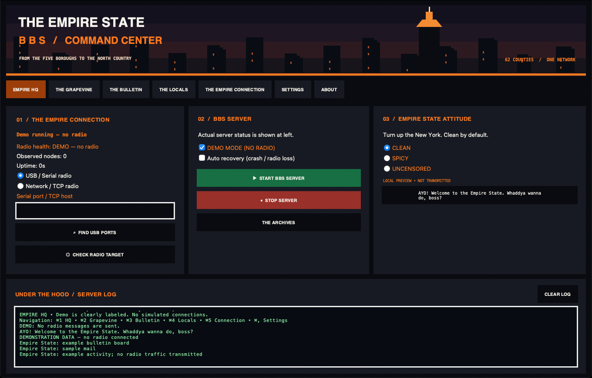

# THE EMPIRE STATE BBS

**New York State Communications Division**

*From the Adirondacks to the Atlantic. Everybody's connected.*

A statewide, old-school New York-themed edition of the Meshtastic bulletin board project, inspired by [THE SITDOWN BBS](https://github.com/BaconDisk22/The-Sitdown-BBS).

> **Project status:** Intel Mac beta.6 is available, and the NYC command-center redesign is merged into the main branch. Automated tests, Intel packaging and a bundled-app smoke test are available; real-radio delivery and normal Finder launch still require hardware verification. [Releases](https://github.com/BaconDisk22/The-Empire-State-BBS/releases).

## Statewide identity

This project represents **all of New York State**, not just New York City: Western New York, the Finger Lakes, Central New York, the Southern Tier, the Capital Region, the North Country, the Mohawk Valley, the Hudson Valley, Long Island, and New York City.

## Screenshots — NYC command center

*Automatically captured desktop preview in **demo mode**. It is not evidence of an active radio connection or over-the-air delivery. Screenshots may reflect the latest successful screenshot workflow rather than a published release.*

[View the full-size dashboard screenshot](docs/images/desktop-preview-demo.png)

The app is a single window with a sidebar: **Dashboard** (Empire HQ), **Messages** (The Grapevine), **Bulletin**, **Locals**, **Connection**, **Radio commands** (The Playbook), **Settings** and **About**. It has light and dark themes (or follows macOS), adjustable text size, and a native menu bar. Shortcuts on Intel Mac: **⌘1** Dashboard, **⌘2** Messages, **⌘3** Bulletin, **⌘4** Locals, **⌘5** Connection, **⌘6** Radio commands, **⌘,** Settings, and **⌘N** for a new message.

More pages, in both themes and with labelled sample data, are in [`docs/images/tour`](docs/images/tour). The design system is described in [`docs/UI_DESIGN.md`](docs/UI_DESIGN.md).

### Visual palette (dark theme)

| Element | Color |
| --- | --- |
| Background | `#0E1015` |
| Surfaces | `#171A21` |
| Crown-orange accent | `#FF8A3D` |
| Primary text | `#F2EFE9` |
| Running / success | `#4ADE80` |

## Implementation and next steps

- Preserve existing radio BBS behavior and compatibility.
- Replace New Jersey-specific names, messages, menus, and assets with statewide New York branding.
- Preserve Intel Mac x86_64 desktop build and DMG workflows, adapting app and artifact names.
- Preserve optional radio-free demo mode and automated README screenshot capture.
- Configure independent GitHub Actions, testing, and releases for this repository.
- Retain upstream attribution and GPLv3 licensing when source code is imported.

## Opening the app on macOS

After downloading the Intel Mac `.dmg` from [GitHub Releases](https://github.com/BaconDisk22/The-Empire-State-BBS/releases), install **The Empire State BBS** in Applications.

1. Open **Applications** in Finder.
2. **Control-click** **The Empire State BBS**.
3. Select **Open**, then **Open** again if prompted.
4. If macOS blocks it, check **System Settings → Privacy & Security → Open Anyway**.

These steps address macOS security prompts for an unsigned app. If the icon bounces in the Dock but no window appears, that may indicate a startup failure rather than a security block; report the issue instead of repeatedly overriding security warnings.

## Source and licensing

**The Empire State BBS** is an independently branded New York adaptation of [The Sitdown BBS](https://github.com/BaconDisk22/The-Sitdown-BBS), which is based on **TC²-BBS by TheCommsChannel**. Thank you to TheCommsChannel and the original contributors for the BBS foundation. Their work made this edition possible.\n\nThe original source credits and copyright notices remain in the source files. This project continues to be distributed under the **GNU General Public License v3.0**; see [LICENSE](LICENSE). New York-themed names, menus, artwork and desktop presentation are specific to this edition.

**The Sitdown BBS remains an independent New Jersey project.**

## NYC command-center dashboard

The dashboard shows the actual server status and radio health, observed node count, uptime, and an activity log. It also has quick links to every section. Messages lists live received text and local drafts, with explicit one-shot sends through the server-owned radio session. Bulletin saves General-board posts and replies locally, and an explicit send submits the selected post as text to one individual node. Locals lists packet observations with recent/stale status and a filter. Demo mode never claims a live connection.

## Build verification

The Intel Mac CI packages the app, checks x86_64 architecture and launches the **actual bundled executable** with `--smoke-test` to confirm Tk and the dashboard initialize. This catches packaging-related startup errors, but it does not replace testing a normal Finder launch on macOS Tahoe or a real Meshtastic device.

### Desktop messaging safety and verification

- Saving mail or a Bulletin post does not transmit. Bulletin posts and replies are also stored in the local BBS General board; they are not automatically synchronized with other BBS servers. Replies retain a local parent relationship. Explicit Bulletin sends are plain text to the selected node, not remote-board replication.
- Send requires a running, ready server, an individual `!1234abcd` recipient, and confirmation of the exact text. Broadcast recipients are rejected. Each radio payload is limited to 200 UTF-8 bytes including its subject/prefix; longer local posts must be shortened in a new record before transmission. No silent splitting occurs.
- The server uses its existing radio interface. Draft → queued → sending is persisted before the radio call. `sent` means submitted to the local radio API, **not RF delivery or acknowledgment**. A radio exception or interrupted send is `unknown`; an unavailable radio before submission is `failed`. Queued records are never replayed on startup or reconnect. Attempted records cannot be resent directly.
- A matching recipient routing response can mark a submitted record `acknowledged` or `failed`. The packet ID and sender must match; unrelated replies and local-node acknowledgments do not establish recipient receipt. An acknowledgment is a protocol observation, not proof of human reading; hardware RF testing remains unverified. Missing acknowledgments leave the submission unconfirmed.
- Explicit retry of a failed attempt creates one durable replacement draft and preserves the original record. It requires confirmation and a separate explicit send. A retry may duplicate a message received despite a routing error. Unknown delivery cannot be retried through this action. Meshtastic firmware may perform its own reliable-send retries when acknowledgment is requested; the desktop does not replay sends on reconnect.
- Live received text is deduplicated by sender and packet ID when available. Last-seen uses local receipt time. SNR/RSSI are shown only when supplied by the latest received packet; relayed packets do not establish a direct link or current online status.
- Desktop messages, observations, and send states persist in `~/.empire-state-bbs/desktop-state.db`. Local Bulletin content uses the existing `bulletins.db`. Legacy drafts and the local BBS database remain accessible from Grapevine.
- Automated tests use mock radio sessions. Hardware RF delivery has **not** been verified. Intel Mac packaging and TCP recovery remain covered by CI. Do not treat a successful CI build as proof of over-the-air delivery.
